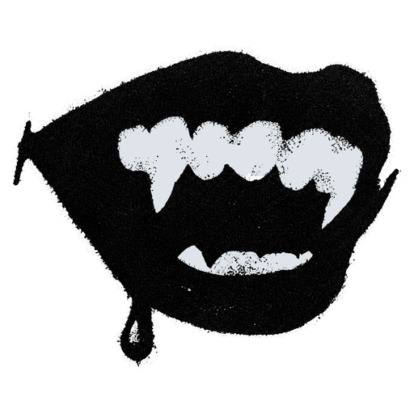

<div align="center">



# Nessacord

A Discord client mod in black and lace. Built on [Vencord](https://github.com/Vendicated/Vencord).

**[Download NessacordInstaller.exe](https://github.com/SerenityDiscko/nessacord/releases/latest/download/NessacordInstaller.exe)**

</div>

## What you get

- **The Nessacord look:** black and lace, ivory serif type, a photo behind the chat, and a matching login screen. Discord's own theme and colour settings don't change it.
- **Your servers in the Nessacord menu:** the server bar is hidden. Click **Nessacord** at the top left to open your servers, or set them to always show.
- **Nessacord everywhere:** the window title, taskbar, tray icon, Start menu and desktop shortcuts, and the app's own text say Nessacord.
- **All of Vencord:** its plugins, themes and settings work as usual.

## Install

1. Download **[NessacordInstaller.exe](https://github.com/SerenityDiscko/nessacord/releases/latest/download/NessacordInstaller.exe)** and run it. It isn't code-signed, so Windows may say it "protected your PC". Choose **More info**, then **Run anyway**.
2. Tick the Discord versions you want Nessacord in (Stable, PTB or Canary), then choose **Install**.
3. Discord restarts with Nessacord.

You need Windows 10 or 11 and the normal Discord desktop app. Nothing else needs installing.

### Updates

Nessacord updates itself from this repo's releases. When Discord updates, Nessacord moves into the new version on its own.

If Nessacord ever fails to start three times in a row, Discord opens without it and tells you. Run the installer and choose **Update / Repair** to fix it.

### Show Nessacord in Task Manager

Task Manager shows the name built into Discord's program file. The **Show Nessacord in Task Manager** option runs Discord from a renamed copy of it, `Nessacord.exe`.

It's off by default because Krisp noise suppression only runs from Discord's own program. With the option on, voice calls use Discord's **Standard** noise suppression instead.

You can turn it on in the installer, or in Nessacord's settings under the **Nessacord** plugin.

### Uninstall

Open **Settings → Apps → Installed apps**, find **Nessacord** and choose **Uninstall**. You can also run the installer and choose **Uninstall**.

Discord goes back to how it was, along with your shortcuts. Your Nessacord settings stay in `%APPDATA%\Nessacord` in case you come back.

### Command line

```
NessacordInstaller.exe --install | --repair | --uninstall | --status
    --discord-root <folder>   only this Discord install (default: Discord, plus any that have Nessacord)
    --dist <folder>           install a local build instead of the latest release
    --data-dir <folder>       Nessacord's data folder (default %APPDATA%\Nessacord)
    --task-manager            turn the Task Manager option on
    --no-task-manager         turn the Task Manager option off
    --quiet                   no windows or questions
```

## Build it yourself

You need [Node.js](https://nodejs.org) 22 or newer and [pnpm](https://pnpm.io).

```
pnpm install
pnpm build --standalone
pnpm buildInstaller
dist\NessacordInstaller.exe --install --dist dist
```

`pnpm buildInstaller` uses the C# compiler that comes with Windows, so it only runs on Windows. Releases are built by `.github/workflows/release.yml` on every push to `main`.

## Credits

- **deargod**, who made Nessacord.
- **bella**, for being fucking amazing.
- **[Vencord](https://github.com/Vendicated/Vencord)** by Vendicated and contributors, which Nessacord is built on.
- **[Cormorant Garamond](https://github.com/CatharsisFonts/Cormorant)** by the Cormorant Project Authors, under the [SIL Open Font License 1.1](assets/fonts/OFL.txt).

## Disclaimer

Nessacord isn't made by, or affiliated with, Discord. Client mods are against Discord's Terms of Service, so use it at your own risk.

## License

Nessacord is free software under the [GNU General Public License v3.0 or later](LICENSE), like Vencord.
